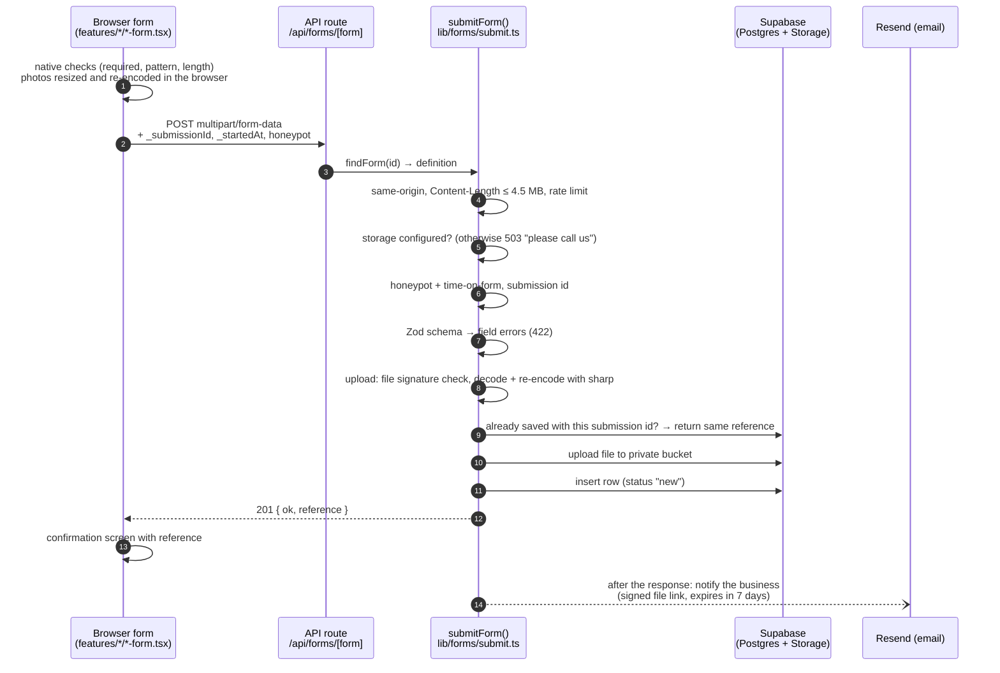
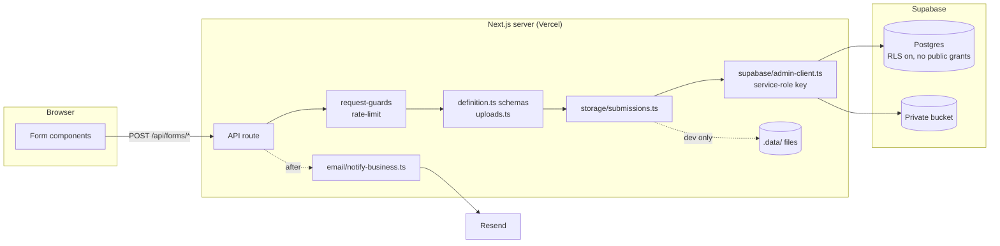

# Architecture

The MaxxCity Mart website is a **Next.js 16 (App Router)** site with React 19, TypeScript and Tailwind CSS 4. Every page is prerendered as static HTML. The only server code that runs per request is one API route, which accepts enquiry forms and stores them in Supabase.

It is a brand and enquiry website. It deliberately has **no** checkout, payments, customer accounts, admin panel, POS, billing or inventory.

## Folder structure

```
MaxxCity-Mart/
├── public/
│   ├── brand/maxxcity-mart-logo.png        original logo (do not redraw)
│   ├── images/storefront/                  real store photography
│   └── social/og-default.jpg               social-share image (logo + storefront)
├── scripts/check-links.mjs                 crawls a running site for broken internal links
├── src/
│   ├── app/                                routes only: pages, layout, metadata files, API
│   │   ├── <page>/page.tsx                 one folder per URL (about, franchise, stores…)
│   │   ├── legal/<policy>/page.tsx
│   │   ├── api/forms/[form]/route.ts       POST endpoint for every enquiry form
│   │   ├── layout.tsx                      fonts, header, footer, organisation JSON-LD
│   │   ├── error.tsx, global-error.tsx     error boundaries
│   │   ├── not-found.tsx                   404
│   │   ├── sitemap.ts, robots.ts, manifest.ts
│   │   └── icon.png, apple-icon.png, favicon.ico
│   ├── components/                         presentation shared across pages
│   │   ├── layout/                         header, footer, mobile action bar, page hero, legal shell, consent banner
│   │   ├── navigation/                     desktop links, mobile menu, breadcrumbs
│   │   ├── sections/                       page sections reused on several pages (₹99 band, store card, FAQ…)
│   │   ├── forms/                          form shell, fields, upload, confirmation (no form-specific logic)
│   │   ├── seo/                            JSON-LD script
│   │   └── ui/                             button, container, section heading, notice, tracked link
│   ├── features/                           one folder per enquiry type
│   │   └── <feature>/
│   │       ├── <feature>-form.tsx          browser form (client component)
│   │       └── definition.ts               server-only: schema, table, reference prefix, email layout
│   ├── content/                            editable business content — see CONTENT_MANAGEMENT.md
│   └── lib/                                logic with no UI
│       ├── config/                         env.ts (server-only), public-env.ts (browser-safe)
│       ├── forms/                          shared field schemas, defineForm, registry, submission pipeline
│       ├── security/                       request guards, rate limiting, upload validation
│       ├── storage/                        saving submissions (Supabase or local dev files), references
│       ├── supabase/                       service-role client
│       ├── email/                          business notification via Resend
│       ├── seo/                            metadata and structured data builders
│       ├── analytics/                      consent-gated event tracking
│       └── links.ts                        tel: and WhatsApp link builders
├── supabase/migrations/                    database schema, RLS and storage bucket (version-controlled)
├── tests/                                  Vitest: unit/, integration/, support/
└── docs/                                   this documentation
```

### Rules the structure follows

| Rule | How |
| --- | --- |
| Routes stay thin | `src/app/**/page.tsx` composes components and content; it holds no business logic. The API route is a ten-line dispatcher. |
| Content is centralised | Phone numbers, address, pricing copy, franchise terms, categories, FAQs and stores live only in `src/content/`. Pages read from there. Tests fail if the sitemap and pages drift apart. |
| Server-only code is marked | Every module that reads secrets or writes data starts with `import "server-only"`; importing it into a client component fails the build. |
| Browser and server validation share one source of truth | Server validation is the Zod schema in each `definition.ts`. The browser uses native constraints (required, pattern, maxLength) for instant feedback and never needs Zod. The browser bundle stays small, and the server never trusts the browser. |
| Option labels are shared | Option lists (e.g. investment readiness) live in `src/content/`, used by both the form (client) and the schema (server), so the email always shows the label the visitor saw. |
| One import alias | `@/` → `src/`. Static images under `public/` are imported relatively for `next/image` blur placeholders. |
| Naming | Files and folders are kebab-case; components are PascalCase; hooks start with `use`; constants are camelCase. |

## Pages and the components they use

| Route | Main pieces |
| --- | --- |
| `/` | hero (storefront photo + `PriceTag`), `PriceBand`, `CategoryGrid`, `Steps`, `StoreCard`, `FounderPortrait`, `FaqList`, `CtaBand` |
| `/about` | `PageHero`, `PriceBand`, `CategoryGrid`, `CtaBand` |
| `/founder` | `PageHero`, `FounderPortrait`, `CtaBand` |
| `/franchise` | `PageHero`, `Steps`, `FaqList`, `CtaBand`, **`features/franchise/franchise-form`** |
| `/request-product` | `PageHero`, **`features/product-requests/product-request-form`** (with `UploadField`) |
| `/stores` | `PageHero`, `StoreCard`, **`features/stores/location-interest-form`** |
| `/manufacturers` | `PageHero`, `Steps`, **`features/manufacturers/manufacturer-form`** (with catalogue `UploadField`) |
| `/retailers` | `PageHero`, **`features/retailers/retailer-form`** |
| `/partner-with-us` | `PageHero`, `CtaBand` (links to each enquiry form) |
| `/contact` | `PageHero`, `StoreCard`, **`features/contact/contact-form`** |
| `/faq` | `PageHero`, `FaqList`, `CtaBand` |
| `/legal/*` | `LegalPage` |

Every page sets its own title, description and canonical URL through `pageMetadata()` (`lib/seo/metadata.ts`). Inner pages add breadcrumbs and `BreadcrumbList` JSON-LD through `PageHero`.

## How a form submission flows



**Statuses the browser can receive:** `201` saved · `200` duplicate retry, original reference returned · `400` spam check or unreadable body · `403` cross-site · `404` unknown form · `411` no Content-Length · `413` too large · `422` field errors · `429` rate limited · `500` save failed · `503` storage not configured.

The confirmation screen appears **only** after the server has saved the submission. It never says that an email was sent, that a product is available, or that an application is approved.

## Data and storage

| Environment | Where submissions go |
| --- | --- |
| Production (any `next build` / Vercel deployment, previews included) | Supabase. If Supabase is not configured, or only partly configured, the API refuses submissions with a 503 and a "please call or WhatsApp us" message. |
| `npm run dev` without Supabase | JSON lines in `.data/<table>.jsonl`, uploads in `.data/uploads/` (git-ignored). |
| Tests | Same local store, in a temporary folder. |

`lib/storage/submissions.ts` decides this (`storageMode()`), and the decision is unit-tested. A half-configured Supabase (URL without key, or the reverse) counts as **unavailable**, never as local.

Six tables, one per form (`supabase/migrations/20261029000000_website_enquiries.sql`):
`franchise_enquiries`, `product_requests`, `manufacturer_enquiries`, `retailer_enquiries`, `contact_enquiries`, `location_interest`.
Each has `reference` (unique), `submission_id` (unique, for de-duplication), `status` (enum), `created_at`, the form's fields in snake_case, and `internal_notes` for the team. Files go to the private `enquiry-uploads` bucket under `<form>/<yyyy-mm>/<reference>/<uuid>.<ext>`. The path contains no personal data.

See [SECURITY.md](SECURITY.md) for the access model.

## Email notifications

`lib/email/notify-business.ts` posts to Resend's HTTP API once a submission is saved, using `after()` so the visitor never waits. It returns `sent`, `not-configured` or `failed`. The outcome is logged and never shown to the visitor. Visitor input is HTML-escaped. If the visitor gave an email address, it becomes the Reply-To.

## Security boundaries



Secrets exist only on the server (`lib/config/env.ts`, marked `server-only`). The browser only ever sees `NEXT_PUBLIC_*` values, read in `lib/config/public-env.ts`.

## Adding a new page

1. Create `src/app/<slug>/page.tsx`. Export `metadata = pageMetadata({ title, description, path: "/<slug>" })`.
2. Compose it from `PageHero`, `components/sections/*` and `components/ui/*`. Put any business copy that may change in `src/content/`.
3. Add it to `src/app/sitemap.ts`. The SEO test fails until you do. If it belongs in navigation, also add it to `src/content/navigation.ts`.
4. Run `npm run check`. With the dev server running, also run `npm run check:links -- http://localhost:3000`.

## Adding a new enquiry form

1. **Migration**: add `supabase/migrations/<timestamp>_<name>.sql` creating the table with the standard columns (`reference`, `submission_id`, `status`, `created_at`, `consent`, `internal_notes`). Enable and force RLS, and revoke from `anon` and `authenticated`, exactly as the existing migration does.
2. **Id**: add the id to `formIds` in `src/lib/forms/types.ts`.
3. **Definition**: create `src/features/<feature>/definition.ts` with `defineForm({ id, label, table, prefix, schema, subject, fields })`. Build the schema from `lib/forms/fields.ts`. Field names in `fields` are type-checked against the schema.
4. **Registry**: add it to `forms` in `src/lib/forms/registry.ts`. The registry test checks that ids, tables and prefixes are unique.
5. **Form**: create `src/features/<feature>/<feature>-form.tsx` using `EnquiryForm` and the components in `components/forms/fields.tsx`. Input `name`s must match the schema keys.
6. **Analytics**: add a `*_submit` event to `AnalyticsEvent` in `lib/analytics/track.ts`.
7. **Tests**: add a valid payload to `tests/support/fixtures.ts`. The integration test then covers saving, duplicates and spam checks automatically when you add the form to its `it.each` table.

Nothing else changes: the route, guards, storage, email and confirmation screen are shared.

## Commands

| Command | Does |
| --- | --- |
| `npm run dev` | development server |
| `npm run check` | lint + type-check + tests |
| `npm test` / `npm run test:watch` | Vitest |
| `npm run build` | production build |
| `npm run check:links -- <url>` | broken internal link check against a running site |
